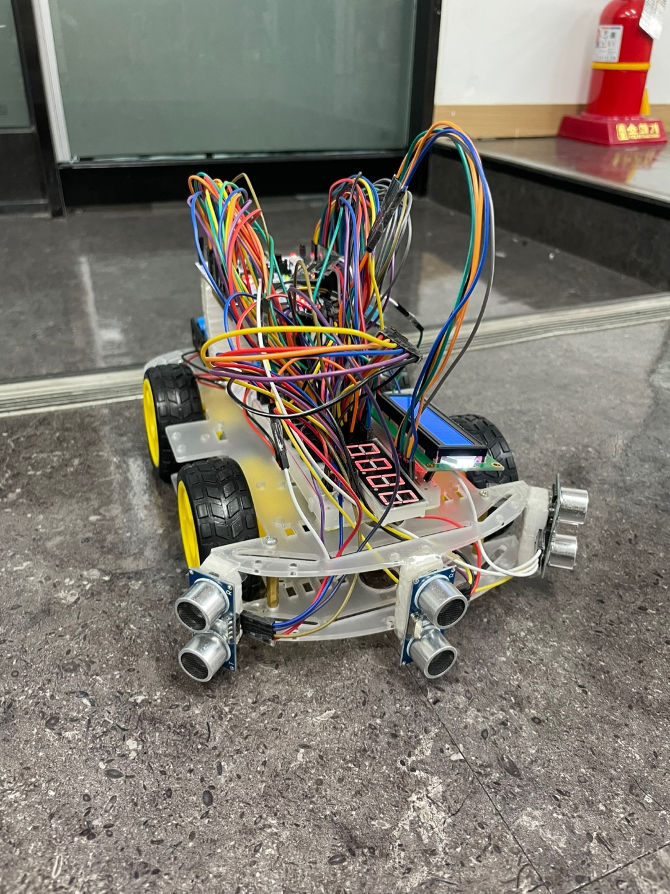
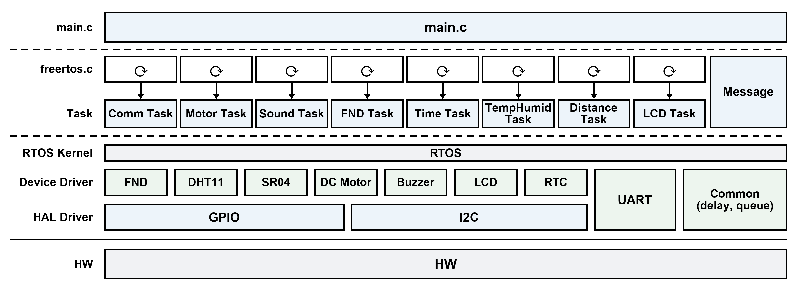

# FreeRTOS 기반 DC 모터 차량 제어

STM32에서 **조이스틱 수동 주행과 초음파 기반 장애물 회피**를 구현한 임베디드 C 프로젝트입니다. 모터 제어, 센서 측정, 통신, 상태 표시를 FreeRTOS 태스크로 나누고, 센서 입력부터 좌우 모터 출력까지 하나의 차량에 통합했습니다.

  

**개발 환경** · Embedded C · STM32F411RETx · STM32CubeIDE · FreeRTOS (CMSIS-RTOS v1) · STM32 HAL

## 주요 기능

| 기능 | 구현 내용 |
| --- | --- |
| 수동 주행 | UART로 받은 조이스틱 각도와 입력 크기를 전·후진 및 조향 명령으로 변환합니다. 좌우 모터의 PWM 출력을 다르게 적용해 방향을 바꿉니다. |
| 자동 주행 | 좌·중앙·우 초음파 센서의 거리값을 조합해 직진, 회전, 후진을 결정합니다. 전·후진 명령이 반복되면 짧게 회전하는 탈출 동작을 적용합니다. |
| 상태 표시 | LCD에 주행 상태, DS3231 시각, DHT11 온·습도를 표시합니다. 4자리 7세그먼트 표시기(FND)는 모터 속도 명령값을, 부저는 상태 변화를 전달합니다. |

## 소프트웨어 구조

코드에서는 위 그림의 8개 기능 태스크와 기본 태스크를 생성합니다. [초기화 코드](./Core/Src/main.c) · [태스크 구성](./Core/Src/freertos.c)

- **통신과 모터 제어 분리** — 통신 태스크가 UART 데이터를 순환 DMA로 받아 명령을 해석합니다. 단일 슬롯 큐에 최신 명령을 덮어쓰고, 모터 태스크가 이를 읽어 좌우 PWM과 회전 방향을 갱신합니다. 모드 변경과 UART 수신 오류 시 정지 명령을 발행합니다. [통신 태스크](./Core/Src/ap/task/comm_task/comm_task.c) · [메시지 큐](./Core/Src/ap/message.c) · [모터 제어](./Core/Src/ap/task/motor_control_task/motor_control_task.c)
- **센서 측정 타이밍 조정** — 초음파 센서를 중앙 → 우측 → 좌측 순서로 트리거하고, 인터럽트로 선택된 센서의 Echo 신호를 처리합니다. 초음파 Echo 측정과 DHT11 읽기가 겹치지 않도록 두 태스크가 측정 상태를 공유합니다. [거리 측정](./Core/Src/ap/task/distance_task/distance_task.c) · [온·습도 측정](./Core/Src/ap/task/temp_humid_task/temp_humid_task.c)
- **공유 I²C 버스 제어** — LCD와 RTC가 사용하는 I²C1 버스 접근을 하나의 뮤텍스로 직렬화합니다. LCD는 내용이 바뀐 영역을 갱신합니다. [LCD 표시](./Core/Src/ap/task/lcd_task/lcd_task.c) · [RTC 읽기](./Core/Src/ap/task/time_task/time_task.c)

## 빌드 및 동작 확인

1. STM32CubeIDE에서 **Existing Projects into Workspace**로 이 폴더를 가져와 빌드합니다. 핀과 주변장치 설정은 [CubeMX 설정 파일](./CH3_RTOS_DC_Motor_Car_Design.ioc)에서 확인할 수 있습니다.
2. 펌웨어를 보드에 다운로드하고 USART6에 명령 송신기를 연결합니다. 통신 설정은 **9600 baud, 8N1**이고, 각 명령 끝에 줄바꿈(LF 또는 CRLF)을 붙입니다.
3. 아래 명령으로 수동 주행과 정지 동작을 확인합니다. 자동 주행은 모드 전환 후 시작 명령을 다시 보내고, 전방 장애물 위치에 따라 차량 출력이 달라지는지 확인합니다.

| 명령 | 동작 |
| --- | --- |
| `T0:0` / `T0:1` | 수동 / 자동 모드 선택 |
| `B1:D` / `B0:D` | 주행 시작 / 정지 |
| `J0:90,0.3` | 수동 모드에서 직진 방향과 속도 명령값 30% 설정 |
